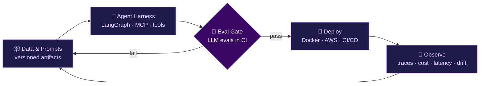

<!-- ═══════════════════════════════════════════════════════════ -->
<!--                     PREMIUM HEADER                        -->
<!-- ═══════════════════════════════════════════════════════════ -->

  

 

 

  

<!-- ═══════════════════════════════════════════════════════════ -->
<!--                      ABOUT ME                             -->
<!-- ═══════════════════════════════════════════════════════════ -->

## 👨‍💻 About Me

  

  

<!-- ═══════════════════════════════════════════════════════════ -->
<!--                     TECH STACK                            -->
<!-- ═══════════════════════════════════════════════════════════ -->

  </img>

  <a href="https://loisekk.github.io/loisekk/Tech%20Stack/tech-stack.html">🏎️ View My Tech Stack 🤖</a>

<!-- ═══════════════════════════════════════════════════════════ -->
<!--        ENGINEERING TELEMETRY  (replaces GitHub Stats)     -->
<!-- ═══════════════════════════════════════════════════════════ -->

## 📡 Engineering Telemetry

## 🏆 LeetCode Info

  
  
  &nbsp;&nbsp;
  

<!-- ═══════════════════════════════════════════════════════════ -->
<!--      SYSTEM BLUEPRINT  (replaces Profile Summary cards)   -->
<!-- ═══════════════════════════════════════════════════════════ -->

## 🏗️ How I Ship AI Systems

Every system I build runs through the same closed loop — nothing reaches production without passing an eval gate, and nothing stays in production without telemetry.

<!-- ═══════════════════════════════════════════════════════════ -->
<!--                  GITHUB TROPHIES                          -->
<!-- ═══════════════════════════════════════════════════════════ -->

  

<!-- ═══════════════════════════════════════════════════════════ -->
<!--            3D CONSTELLATION CONTRIBUTION GRAPH            -->
<!-- ═══════════════════════════════════════════════════════════ -->

## 🌌 3D Contribution Graph

  

  ✨ Contribution history rendered as an animated 3D constellation

<!-- ═══════════════════════════════════════════════════════════ -->
<!--               PIXEL NAME ART (GREEN BLOCKS)               -->
<!-- ═══════════════════════════════════════════════════════════ -->

  

  🟩 Name rendered in GitHub contribution-style green pixel blocks

<!-- ═══════════════════════════════════════════════════════════ -->
<!--     ARCADE CONTRIBUTION GRAPH  (replaces Snake)           -->
<!-- ═══════════════════════════════════════════════════════════ -->

## 👾 Contribution Arcade

  <picture>
    <source media="(prefers-color-scheme: dark)" srcset="https://raw.githubusercontent.com/loisekk/loisekk/pacman-output/pacman-contribution-graph-dark.svg">
    <source media="(prefers-color-scheme: light)" srcset="https://raw.githubusercontent.com/loisekk/loisekk/pacman-output/pacman-contribution-graph.svg">
    
  </picture>

  🟡 Pac-Man eats my real contributions — regenerated daily by GitHub Actions

<!-- ═══════════════════════════════════════════════════════════ -->
<!--   PRODUCTION ENGINEERING FOCUS (replaces Learning Roadmap)  -->
<!-- ═══════════════════════════════════════════════════════════ -->

## 🏭 Production Engineering Focus

  

👇 Expand a domain to see what I build, ship, and operate

<b>🔭 LLMOps</b> — running LLM systems in production

 

- Prompt & model versioning, config-driven releases, rollbacks
- Tracing and observability across every LLM and tool call
- Cost, latency, and token budgets enforced per request
- Guardrails, fallbacks, caching, and model routing

<b>⚙️ MLOps</b> — reproducible pipelines, automated delivery

 

- Experiment tracking, data and model versioning, model registry
- CI/CD for training and serving pipelines
- Containerized, reproducible environments
- Monitoring for data drift and model degradation

<b>🧪 LLM Evals</b> — measuring quality before users do

 

- Golden datasets and regression suites wired into CI as release gates
- LLM-as-judge with calibrated rubrics, plus human review loops
- RAG metrics: faithfulness, context precision, context recall
- Agent trajectory and tool-use evaluation

<b>🕸️ Multi-Agent Harness Engineering</b> — orchestration that survives production

 

- Stateful multi-agent graphs with LangGraph
- MCP servers and strict tool-calling contracts
- Retries, timeouts, step budgets, and human-in-the-loop checkpoints
- Sandboxed execution and a reproducible agent evaluation harness

<b>☁️ AWS & Cloud Infrastructure</b> — deploying and operating at scale

 

- Compute and serving: Lambda, ECS/Fargate, EC2
- Storage and data: S3, managed Postgres, Redis
- Security and ops: IAM least-privilege, secrets management, CloudWatch
- Infrastructure as code and automated deploy pipelines

<b>🔎 RAG & Retrieval Systems</b> — grounded, measurable answers

 

- Hybrid retrieval (dense + keyword) with reranking
- Chunking and indexing strategy tuned against eval results
- Vector stores in production, with freshness and access control

<b>🚦 Serving, APIs & Reliability</b> — the layer users actually touch

 

- FastAPI services with async I/O and streaming responses
- Queues, rate limiting, and graceful degradation
- Prompt-injection defenses and input/output validation

<!-- ═══════════════════════════════════════════════════════════ -->
<!--                  FOUNDER — OPENML                         -->
<!-- ═══════════════════════════════════════════════════════════ -->

## 🚀 Founder & Lead Developer — OpenML

|  |  |
|:--|:--|
| **Role** | Founder & Lead Developer |
| **Product** | AutoML pipeline tooling — data in, trained and evaluated model out, from the command line |
| **Install** | `pip install open-mlpipe` |
| **Documentation** | [openml-docs.vercel.app](https://openml-docs.vercel.app/) |
| **Company page** | [OpenML on LinkedIn](https://www.linkedin.com/company/openml-flow/) |

<!-- ═══════════════════════════════════════════════════════════ -->
<!--                      CONTACT                              -->
<!-- ═══════════════════════════════════════════════════════════ -->

## 🌍 Let's Connect

📍 Bhopal, Madhya Pradesh, India &nbsp;|&nbsp; 🎓 AIML @ OIST &nbsp;|&nbsp; 📧 yashbrahmankar95@gmail.com

 

 
<b>⚡ Building Intelligent AI Systems Today — For a Smarter Tomorrow ⚡</b>

<!-- ═══════════════════════════════════════════════════════════ -->
<!--                      PORTFOLIO                            -->
<!-- ═══════════════════════════════════════════════════════════ -->

 

Projects, live demos, and interactive 3D work — all in one place.

 

<!-- ═══════════════════════════════════════════════════════════ -->
<!--                    FOOTER                                 -->
<!-- ═══════════════════════════════════════════════════════════ -->

